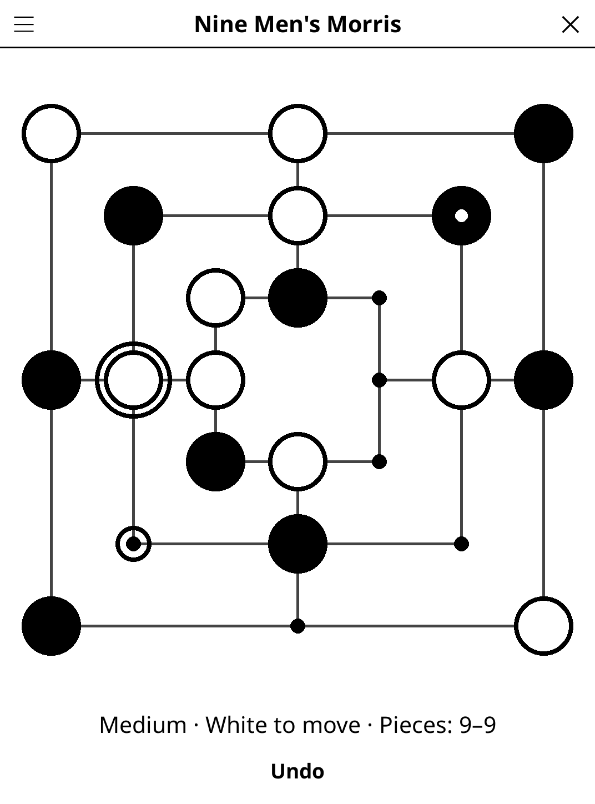

# morris.koplugin

Nine Men's Morris (jeu du moulin, Mühle) for
[KOReader](https://github.com/koreader/koreader): form mills and take your
opponent's pieces, against the AI or a friend on the same device.

## Screenshot

## Rules

Each player has nine pieces; White plays first.

1. **Placing** — in turn, place a piece on any empty point.
2. **Moving** — once all pieces are placed, slide one of your pieces along a
   line to the next point if it is empty.
3. **Flying** — with only three pieces left, a piece may move to any empty
   point.

Three of your pieces in a row along a line form a **mill**, which lets you
remove an opponent piece — not one standing in a mill, unless all of them do.
You lose when you are down to two pieces or cannot move. The game is drawn when
a position comes back a third time, or after 100 moves with no piece removed.

## Features

- **1 player vs AI** (easy / medium / hard) or **2 players** on one device
- **Play as White or Black** against the AI
- **Move help** — the selected piece is ringed and its destinations circled;
  after a mill, the pieces you may take are crossed
- **Undo** — against the AI, takes back the AI's reply and your move
- **Auto-save** — the game, with its undo history, is restored on next launch

## The AI

Negamax with alpha-beta pruning and iterative deepening on a think-time
budget. The evaluation counts material, lines one piece short of a mill, and
mobility for a side that has to slide. Easy searches 2 plies with a large
random margin, medium 3 plies with a small one, hard as deep as 1 s of CPU
time allows. The budget is CPU time, so a slower e-reader searches less deep
rather than waiting longer.

## Installation

1. Download `morris.koplugin.zip` from the [latest release](../../releases/latest).
2. Extract into the `plugins/` folder of your KOReader data directory.
3. Restart KOReader.
4. Open the menu → **Tools** → **Nine Men's Morris**.

## Controls

| Action | How |
|--------|-----|
| Place a piece | Tap an empty point |
| Move a piece | Tap it, then tap where it goes |
| Remove a piece after a mill | Tap a crossed opponent piece |
| Take back a move | Tap **Undo** |
| New game, difficulty, players, colour, rules | Title-bar menu |

## License

GPL-3.0 — see [LICENSE](LICENSE).
